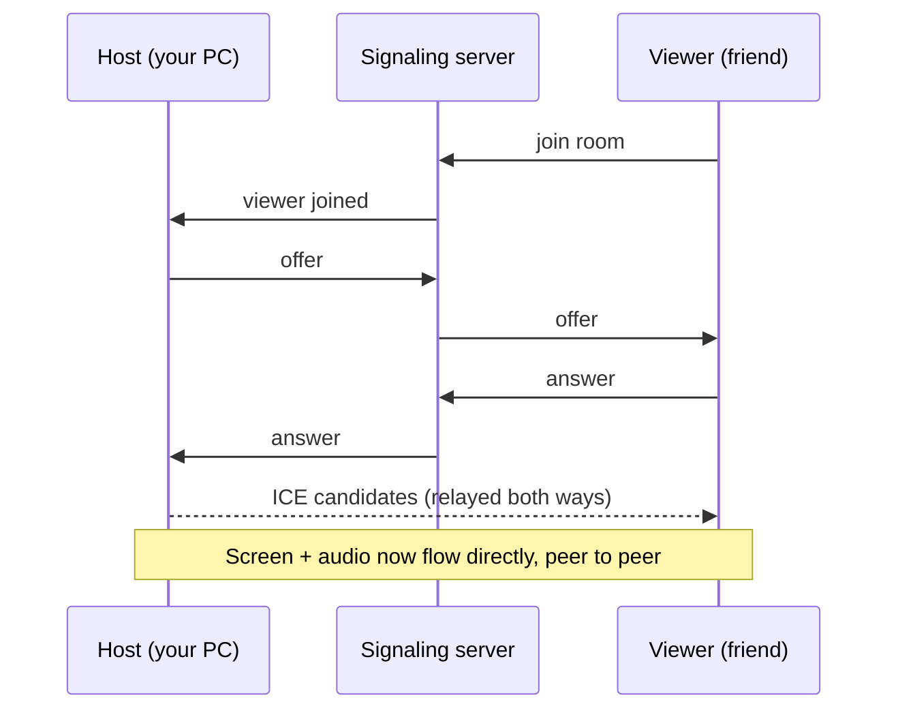

# 🖥️ Screen Share

### Share your screen *and* system audio with a friend. Peer-to-peer, no accounts, no time limit, no quality cap.

[](https://nodejs.org) [](https://webrtc.org) [](https://github.com/websockets/ws) [](https://developer.mozilla.org/en-US/docs/Web/JavaScript) [](https://www.docker.com) [](https://www.nginx.com)

A tiny self-hosted web app: click **Create room**, send your friend the link, hit **Start sharing**. Your screen and *whatever you're hearing on your PC* (games, VLC, social media, anything) go straight to their browser.

## 🤔 Why I built this

I wanted to show a friend a video file with audio over a call, and every free option got in the way:

- 🎮 **Discord** (free tier) caps screen share at 720p.
- 📹 **Google Meet** can't share audio from desktop apps.
- 🕐 **Zoom** (free) cuts calls off at 40 minutes.

So this is a ~400-line WebRTC app that has none of those limits.

## ✨ Features

- 🔗 **One-link rooms**: a random UUID per room, nothing to sign up for
- 🔊 **System audio**: games, media players, browser, all of it (stereo, high-bitrate Opus)
- 🎞️ **Up to 1080p60**: video bitrate capped at 8 Mbps per viewer, tuned for motion
- 🔒 **Peer-to-peer and encrypted**: video and audio never touch the server
- 👥 **Choose how many viewers** (1 to 4, or a custom number up to 50)
- 🪶 **Tiny**: one dependency (`ws`), no build step, plain HTML/JS on the page
- 🔐 **Host token**: only the room's creator can host it, the viewer link can't hijack a room
- 🐳 **Docker + nginx ready** for a small VPS

## 🧠 How it works

The two browsers talk to each other directly using **WebRTC**. They just need a middleman once, to swap connection details (this is called *signaling*). That's all the Node server does: it relays small JSON messages over WebSockets.



## 🚀 Quick start (local)

Requires **Node.js 18+**.

```bash
git clone https://github.com/arijitcodes/screen-share.git
cd screen-share
npm install
npm start
```

1. Open **http://localhost:3000** on the PC that will share (use `localhost`, browsers only allow screen capture on secure origins).
2. Click **Create room**. The link box shows a LAN address (e.g. `http://192.168.x.x:3000/r/...`).
3. Open that link on another device on the same network, click **Join & watch**.
4. Back on the host, click **Start sharing**.

> 💡 If the other device can't connect, allow Node through the Windows firewall:
> ```powershell
> New-NetFirewallRule -DisplayName "screen-share" -Direction Inbound -Protocol TCP -LocalPort 3000 -Action Allow -Profile Private
> ```

## 🎬 Using it

**Host** (desktop **Chrome or Edge**):

1. Create a room and send the link.
2. Choose **Max viewers** if you want more than one person.
3. Click **Start sharing**, pick **Entire screen**, and tick **Share system audio**.

**Viewer** (any modern browser, phones included): open the link, click **Join & watch**. That click also lets the browser play sound.

### 🔈 Audio notes

- Window and tab shares can't carry audio from other apps. To share a game or VLC, share the **entire screen** with system audio on.
- System audio capture includes **everything you hear**, including a Discord call on the same PC, so your friend would hear themselves. Keep the call on another device (e.g. your phone), or route it to a different output.
- Hosting from Firefox or mobile browsers isn't supported (no system audio, or no screen capture at all).

## 🌐 Deploy to a server (Docker + nginx)

Screen capture needs **HTTPS**, so use a domain or subdomain. Plain `http://<ip>` won't work for the host.

```bash
# 1. Start the container (listens on 127.0.0.1:3000 only)
docker compose up -d --build

# 2. Add the nginx site (edit server_name first)
sudo cp screenshare.nginx.conf /etc/nginx/sites-available/screenshare
sudo ln -s /etc/nginx/sites-available/screenshare /etc/nginx/sites-enabled/
sudo nginx -t && sudo systemctl reload nginx

# 3. Get a certificate (DNS A record must already point at the server)
sudo certbot --nginx -d share.yourdomain.com
```

- Keep the port binding as `127.0.0.1:3000:3000` in production. Docker bypasses UFW, so `0.0.0.0` would expose the app over plain HTTP. Use `0.0.0.0` only for a local LAN test.
- The nginx config proxies WebSockets and sets long timeouts so signaling stays alive for the whole session.
- Media doesn't pass through the server, so it needs almost no bandwidth or CPU.

## ⚙️ Configuration

| What | Where | Default |
| --- | --- | --- |
| Server port | `PORT` env var | `3000` |
| Video bitrate cap (per viewer) | `VIDEO_MAX_BITRATE` in `public/index.html` | `8_000_000` |
| Max viewers | Host page dropdown (server limit in `server.js`) | `1` (up to `50`) |
| STUN servers | `ICE_CONFIG` in `public/index.html` | Google public STUN |

> **Behind CGNAT or a strict firewall?** A direct connection may fail ("Could not connect"). Add a TURN server to `ICE_CONFIG`. Note that a TURN relay carries all the video traffic, so it needs real bandwidth.

## 📁 Project structure

```
screen-share/
├── server.js               # web server + WebSocket signaling (rooms, relay rules)
├── public/
│   └── index.html          # the whole UI and the WebRTC client (host + viewer)
├── Dockerfile
├── docker-compose.yml
├── screenshare.nginx.conf  # nginx site config (WebSocket proxy)
├── package.json
└── package-lock.json
```

## 🔐 Privacy & security

- Media is encrypted end to end between the two browsers (DTLS-SRTP).
- The server only sees room IDs, IP addresses and the connection handshake. It never sees video or audio.
- Google's public STUN server only learns that your IP asked for its public address.
- Host and viewers can see each other's IP (inherent to peer-to-peer).
- **The viewer link is the only password**, so share it only with people you trust. The room's max-viewers limit caps who can join.
- Rooms live in memory only and disappear when empty.

## 🛠️ Troubleshooting

| Problem | Fix |
| --- | --- |
| No sound on the viewer | Host must tick **Share system audio** and share the **entire screen** in Chrome/Edge |
| Friend hears themselves | Your call audio is in the capture, move the call to another device |
| Black video while gaming | Use borderless windowed mode instead of exclusive fullscreen |
| Phone can't open the LAN link | Allow port 3000 in the firewall; make sure the PC's network is set to Private |
| "Could not connect" | A network is blocking direct connections, add a TURN server |
| Video starts muted on a phone | The browser blocked autoplay sound, tap the video's unmute button |
| **Create room** does nothing | Open the app via `localhost` or HTTPS (needs a secure origin) |

## 🚨 Slop Declaration

> **Warning: this repo contains AI slop.** 🍝
>
> Pair-programmed with **Claude**. I told it "make no mistakes" and it said "sure". 🫡 It wrote the code, I asked "are you sure?" a lot, and then we both hit LGTM. 🚀
>
> Any bugs will be split 50-50, no negotiation. 🤝
>
> Bug reports and PRs are welcome. Humans preferred, but I won't ask for ID. 🙏🏻

## 🤝 Contributing

Issues and PRs are welcome. Commits follow [Conventional Commits](https://www.conventionalcommits.org) (`feat:`, `fix:`, `docs:`, ...).

## 👨🏻‍💻 Author

Built by **Arijit Banerjee**, a Node.js software engineer who likes real-time things. 🔥

[](https://www.linkedin.com/in/arijitban) [](https://github.com/ArijitCodes) [](mailto:arijit.codes@gmail.com)

🌐 Portfolio: [iamarijit.dev](https://iamarijit.dev)
